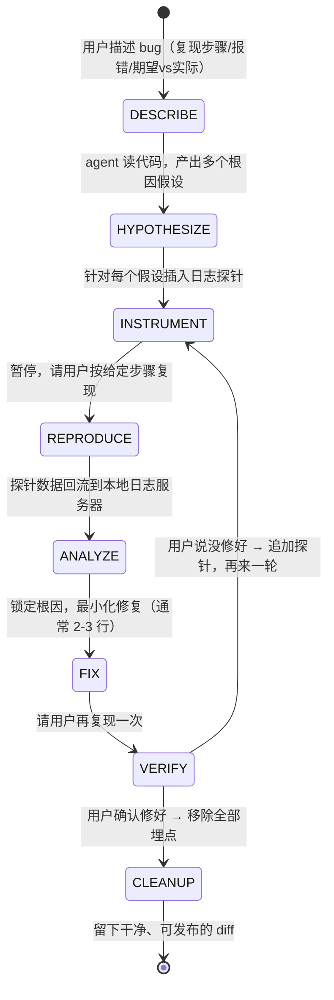
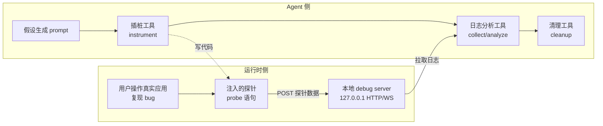

# Cursor Debug Mode 原理拆解与复刻指南

> 目标读者：想在自己常用的 agent（Pi / oh-my-pi / Claude Code）里复刻 Cursor Debug Mode 体验的开发者。
> 本文基于 Cursor 官方博客（cursor.com/blog/debug-mode）与官方文档（cursor.com/docs/agent/debug-mode）的公开信息，结合工程推断，把"能复刻的部分"拆到可实现的程度。

---

## 1. 它到底解决什么问题

普通 coding agent 修 bug 的信息通道是：**静态代码 + 你的文字描述**。它从未见过 bug 发生时程序的内部状态，所以对以下类别的 bug 只能猜：

- 竞态条件、时序问题（依赖执行顺序 / 异步行为）
- 性能问题、内存泄漏（需要运行时画像才能理解）
- 回归（"以前是好的"——需要追溯什么变了）
- 能复现但读代码看不出原因的问题

Cursor Debug Mode 的解法是把另一条信息通道接进来：**运行时证据**。公式化的对比：

```
普通 Agent:    读代码 → 猜原因 → 一次性输出大段补丁 → 你人工试错
Debug Mode:    提假设 → 插桩埋点 → 你复现 → 读运行时日志 → 2-3 行精准修复 → 你验证 → 清理埋点
```

两个不可省略的设计支柱：

1. **运行时信息**（runtime evidence）：agent 自己埋日志、自己收日志
2. **人在环**（human-in-the-loop）：复现和"修没修好"的最终判断由人完成，因为有些修复"技术上可行但感觉不对"，agent 判断不了

---

## 2. 核心循环状态机

官方文档描述的流程，整理成一个显式状态机（这是复刻时最重要的骨架）：



每一轮的产物：

| 阶段 | agent 产出 | 用户产出 |
|---|---|---|
| DESCRIBE | 复现步骤清单（给用户执行） | bug 描述 + 报错/堆栈 |
| HYPOTHESIZE | N 个根因假设（编号、可证伪） | — |
| INSTRUMENT | 探针注入的代码 diff | — |
| REPRODUCE | — | 在真实应用里触发 bug |
| ANALYZE | 基于日志的根因结论 | — |
| FIX | 最小修复 diff | — |
| VERIFY | — | 复现并判定是否修好 |
| CLEANUP | 移除探针后的最终 diff | 确认收货 |

**复刻要点：**
- 假设必须是**多个且可证伪**的。单假设 = 普通猜法换皮。每个假设要能映射到"哪个探针能证实/证伪它"。
- "复现"和"验证"两个阶段是**硬暂停点**。插件必须能停止 agent 循环、把控制权交还用户、等用户回来说"复现完了"再继续。这是整个复刻里最像产品、也最容易被忽略的部分。
- 没修好时**回到 INSTRUMENT 而不是回到 FIX**——加证据，不是换猜测。

---

## 3. 关键组件架构

官方披露的实现细节只有一句关键信息："agent 在代码中加入日志语句，这些语句把数据发送到**运行在 Cursor 扩展里的本地 debug server**"。据此可以还原出四个组件：



### 3.1 探针（probe）

插进用户代码的日志语句。它不是普通 `console.log`，要满足：

- **带回传地址**：把结构化数据发到本地 server（浏览器场景走 `fetch` POST；Node 场景走内置 HTTP 客户端或直接写 Unix socket）
- **带身份**：每个探针有唯一 id + 关联的假设编号，日志回流后才能知道"哪条证据验证了哪个假设"
- **结构化负载**：时间戳、线程/任务上下文、变量名/值、调用位置
- **可清理**：见 3.3

浏览器场景的最小探针示例（TypeScript）：

```ts
// [probe:p7f3|h1] ← 哨兵注释，清理时靠它定位
fetch('http://127.0.0.1:37541/probe', {
  method: 'POST',
  keepalive: true, // 页面即将崩溃/跳转时也要把日志发出去
  headers: { 'content-type': 'application/json' },
  body: JSON.stringify({
    probe: 'p7f3', hypothesis: 'h1',
    ts: performance.now(),
    where: 'src/auth/session.ts:142 onRefresh',
    data: { userId, tokenAge, isExpired, queueLen: pending.length },
  }),
});
```

`keepalive: true` 是关键细节：很多 bug 的最后时刻伴随页面跳转或崩溃，普通日志会丢。

### 3.2 本地 debug server

一个小型 HTTP/WS 服务，只监听 127.0.0.1：

- `POST /probe`：接收探针数据，按 probe id / 假设编号归档
- `GET /logs`（或 WS 订阅）：给 agent 的日志拉取工具用，支持按 probe/假设/时间窗过滤
- 每轮复现结束打一个 "reproduction session" 边界，让 agent 能对齐"第 1 次复现 vs 第 2 次复现"的数据（验证阶段需要对比）

Bun/Node 下 60 行就能写完。把它做成插件的一部分（extension 启动时拉起，会话结束关闭），而不是独立进程。

### 3.3 埋点登记与清理

清理的可靠性决定了这个模式的可用性——没人愿意手删几十个探针。两种做法，推荐叠加：

1. **哨兵注释**：每条探针都带唯一标记（如 `[probe:p7f3|h1]`）。清理 = 全库精确删除带标记的语句行。简单、语言无关，agent 用编辑工具就能执行。
2. **git 保护网**：进入 INSTRUMENT 前先把工作区 commit（或 `git stash create`）一次。兜底方案是 `git checkout` 回滚所有插桩改动，只 cherry-pick 修复部分——通过"修复提交与插桩提交分离"保证最终 diff 干净。

工程上建议：插桩阶段只做加法（不修改原有语句），修复阶段单独成 commit。这样 cleanup 永远可以机械执行。

### 3.4 假设生成的 prompt

这是"智能"所在，也是最容易写弱的部分。要点：

- **先探索再假设**：强制 agent 先读相关代码路径、构建上下文，禁止跳过直接给方案
- **数量下限**：至少 3 个互斥性较强的假设，覆盖不同层（数据、控制流、时序、环境）
- **可证伪表述**：每条假设必须附带"如果为真，探针应看到什么；如果为假，应看不到什么"
- **探针映射**：每条假设至少绑定一个探针位置（文件:函数）

可以直接用的 prompt 骨架（放进 system prompt / skill 正文）：

```
你是调试工程师。用户描述的 bug 如下：
{{bug_description}}

阶段 1 — 探索：先通读相关代码路径再回答，禁止直接给修复。
阶段 2 — 假设：给出至少 3 个根因假设。每条包含：
  - 假设陈述（一句话）
  - 证实信号：若为真，探针应观察到什么
  - 证伪信号：若为假，探针应观察不到什么
  - 建议探针位置（文件:函数）与需采集的变量
阶段 3 — 插桩：用 instrument 工具在每个建议位置插入探针，
  只添加语句，不修改既有代码。
阶段 4 — 移交：输出给用户的复现步骤，然后停止，等待用户确认复现完成。
阶段 5 — 分析：用 collect 工具读取日志，逐条对照假设的证实/证伪信号，
  得出根因结论。禁止在证据不足时宣称定位成功。
阶段 6 — 修复：只修改根因对应的 2-3 行，禁止防御性大改。
阶段 7 — 验证：请用户再复现一次。若用户报告未修复，回到阶段 3 追加探针。
阶段 8 — 清理：用户确认后，用 cleanup 工具删除全部探针，汇报最终 diff。
```

---

## 4. 复刻成 Pi / oh-my-pi 插件

Pi 的扩展模型：TypeScript 扩展文件，通过 package manifest 声明，`pi install npm:<pkg>` 分发。扩展可以注册**自定义工具**和 **slash 命令**（参考 `pi-browser-debug` 的结构：`{ "extensions": ["./extensions/index.ts"] }`）。

### 4.1 工具面设计

一个 `pi-debug-loop` 扩展建议暴露 5 个工具：

| 工具 | 作用 | 内部实现 |
|---|---|---|
| `debug_instrument` | 在指定文件:位置插入探针 | 生成探针代码（带哨兵注释）+ AST/regex 插入 + 登记 `probes.json` |
| `debug_server` | 启动/停止本地日志服务器 | Bun/Node HTTP server，127.0.0.1 随机端口 |
| `debug_collect` | 拉取本轮复现的日志 | 读 server 的归档，按探针/假设过滤后返回摘要 |
| `debug_cleanup` | 删除全部探针 | 按 `probes.json` + 哨兵注释精确移除，校验工作区与插桩前一致 |
| `debug_state` | 读/写循环状态机 | 会话目录下的 `state.json`（当前阶段、假设列表、复现轮次） |

### 4.2 结构草图

```
pi-debug-loop/
├── package.json          # Pi manifest
├── extensions/
│   └── index.ts          # 注册工具 + /debug 命令
├── server/
│   └── index.ts          # 本地日志服务器（<100 行）
└── README.md
```

`extensions/index.ts` 骨架（伪代码，按 pi 扩展 API 调整）：

```ts
import { server, ProbeStore } from '../server/index.js';

export default function register(ctx) {
  const store = new ProbeStore('.debug-session/probes.json');

  ctx.tool('debug_instrument', {
    description: '在代码中插入调试探针，绑定假设编号',
    params: { file: 'string', anchor: 'string', hypothesis: 'string',
              capture: 'string[]' },
    async run({ file, anchor, hypothesis, capture }) {
      const id = store.add({ file, anchor, hypothesis, capture });
      const probe = buildProbeCode(id, hypothesis, capture); // 带哨兵注释
      return ctx.edit(file, insertAfter(anchor, probe));
    },
  });

  ctx.tool('debug_collect', {
    description: '读取最近一次复现会话的探针日志',
    params: { session: 'number?', hypothesis: 'string?' },
    async run(q) { return server.query(q); },
  });

  ctx.tool('debug_cleanup', {
    description: '删除全部探针，恢复干净工作区',
    async run() {
      const removed = await store.removeAll(ctx); // 哨兵匹配逐条删
      return `removed ${removed} probes, workspace clean`;
    },
  });

  ctx.slash('/debug', startLoop);  // 进入循环：注入假设生成 prompt
  ctx.slash('/debug-repro-done', () => store.markReproDone()); // 用户复现完成的回路口
  ctx.slash('/debug-verified', () => store.advance('CLEANUP'));
}
```

### 4.3 用户交互的两个暂停点

`/debug-repro-done` 和 `/debug-verified` 这类**回口命令**是人在环的落地形式：agent 在 REPRODUCE/VERIFY 阶段停下，用户操作完真实应用后敲一个命令把循环续上。比让用户打自然语言"我复现完了"可靠得多。

### 4.4 前端场景增强

配合之前调研的生态包可以拼出完整前端链路：

- `pi-browser-debug` / `pi-browser-harness`：浏览器侧 console、失败请求、HTTP 错误的持久收集——**非埋点类的免费证据源**，分析阶段与探针日志合并
- `@aliou/pi-processes`：dev server 常驻后台，复现期间日志持续入库
- omp 用户：以上全部可用，外加 `debug`（DAP）工具——Node/SSR 侧可以下真断点替代部分埋点

---

## 5. 复刻成 Claude Code 插件

Claude Code 的扩展面是 **Skills**（`SKILL.md` + 脚本）、**hooks**、subagents。没有自定义工具注册，所以工具面要用"skill + 辅助脚本"的方式落地：

```
.claude/skills/debug-mode/
├── SKILL.md            # 假设生成的完整 prompt + 阶段纪律（第 3.4 节骨架）
├── server.mjs          # 本地日志服务器（node 直接跑）
└── scripts/
    ├── instrument.mjs  # 探针插入（file + anchor + hypothesis + vars）
    ├── collect.mjs     # curl 127.0.0.1:port/logs 过滤输出
    └── cleanup.mjs     # 哨兵注释全删 + git 一致性校验
```

落地方式差异：

| 能力 | Pi 插件 | Claude Code |
|---|---|---|
| 自定义工具 | 原生注册 | 没有——skill 里的 bash 脚本充当工具 |
| 循环暂停/回口 | slash 命令 | 用户手动说"复现完了"，或 hooks（如 Stop hook 检查 state.json 阶段）辅助 |
| 状态机持久化 | 扩展内 state | `.debug-session/state.json`，SKILL.md 指示 agent 每阶段读写 |
| 埋点清理 | cleanup 工具 | cleanup.mjs 脚本 + git 兜底 |

**Claude Code 的关键纪律写在 SKILL.md**：因为 agent 可以自由执行命令，必须在 skill 里显式约束"插入探针只准用 instrument.mjs、清理只准用 cleanup.mjs、禁止手写 console.log 充当探针"——否则 agent 会在第 3 轮开始随手撒 log，清理退化为人工劳动。

---

## 6. 插桩 vs DAP 断点：什么时候用哪条路线

| 维度 | 插桩日志（Cursor 路线） | DAP 断点（omp 路线） |
|---|---|---|
| 前置条件 | 无——任何能跑的代码都能埋 | 需要目标语言的 debug adapter |
| 能看到什么 | 只有你埋的点 | 任意栈帧、任意变量、任意表达式 |
| 对时序的干扰 | 侵入小，异步时序基本保真 | 断点会挂起程序，时序敏感 bug 会被改变行为 |
| 浏览器页面内 | 完美适配（页面即运行时） | 需要给浏览器接 CDP/js-debug，成本高 |
| 清理成本 | 必须有 cleanup 机制 | 零——断点不落盘 |

前端页面内逻辑用插桩；Node/SSR/构建链路用 DAP；两者可以在同一个循环里混用（DAP 会话也作为"证据源"之一喂给 ANALYZE 阶段）。

---

## 7. 工程注意事项（踩坑清单）

1. **探针必须只做加法**。修改原有语句会让清理变成不可逆手术。
2. **热路径性能**。每条探针一个 `fetch` 在高频循环里会拖垮复现。给探针加采样参数（每 N 次发一次），或让高频探针先攒在内存、页面卸载时 `keepalive` 批量冲一次。
3. **日志量控制**。ANALYZE 前先聚合（每探针 count + 首末样本 + 异常样本），不要把 10MB 原始日志塞进上下文。
4. **端口固定 vs 随机**。随机端口写进 `state.json`；硬编码端口会在两个会话并行调试时互踩。
5. **崩溃场景**。`keepalive`、`visibilitychange`/`pagehide` 冲刷、Node 侧 `process.on('exit')` 兜底——最容易丢证据的恰恰是崩溃型 bug。
6. **多轮复现对齐**。每次 `/debug-repro-done` 打一个 session 边界，验证阶段才有"修复前 vs 修复后"的对比依据。
7. **别追求全自动**。复现和最终判定留给用户不是妥协，是设计——这恰恰是 Cursor 这套模式比"全自动修 bug agent"成功率高的原因。

---

## 8. 最小可行版本（MVP）路线

如果只想花一个周末验证这条路：

1. **D0-半天**：写本地日志服务器（server.mjs，<100 行）+ 哨兵注释格式的探针模板
2. **D0-剩余**：把 3.4 的 prompt 骨架放进 AGENTS.md / CLAUDE.md / SKILL.md，不写任何工具——让 agent 用普通编辑工具手动插桩、用 curl 收日志
3. **D1**：真实 bug 上跑 2-3 轮，观察 agent 在哪个阶段失控（通常是：跳过假设直接修、或乱撒 console.log）
4. **D1-末**：只针对失控的阶段写脚本/工具做硬约束（instrument.mjs / collect.mjs / cleanup.mjs）
5. 之后再考虑做成正式 pi package（manifest + 扩展注册）分发

先流程、后工具、再产品化——Cursor 自己也是把"优秀调试工程师的工作流"先编码成 prompt 循环，再配的工具。

---

## 参考来源

- Cursor 官方博客：Introducing Debug Mode — Agents with runtime logs（cursor.com/blog/debug-mode）
- Cursor 官方文档：Debug Mode（cursor.com/docs/agent/debug-mode）
- Pi 扩展/包体系：pi.dev（`pi install`、package manifest、扩展 API）
- pi-browser-debug / pi-browser-harness / @aliou/pi-processes / @narumitw/pi-chrome-devtools 等生态包（pi.dev/packages）
- oh-my-pi debug 工具（DAP，28 操作）：github.com/can1357/oh-my-pi
